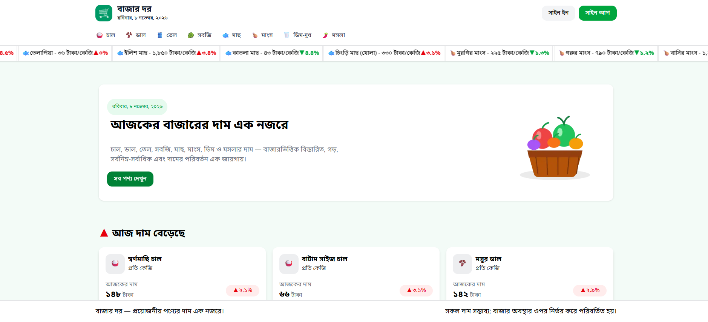
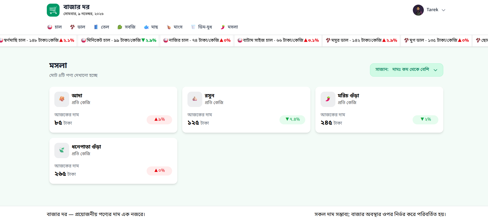
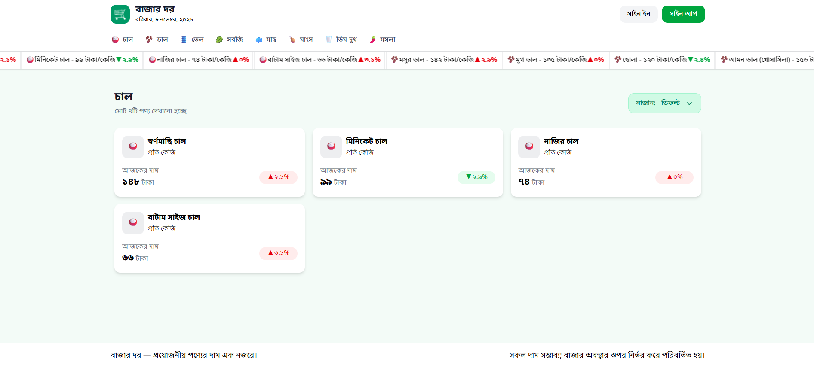
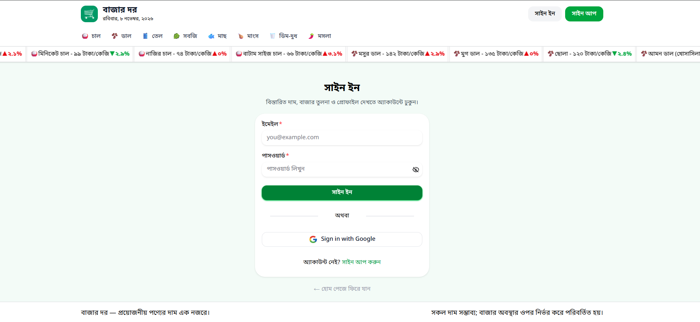
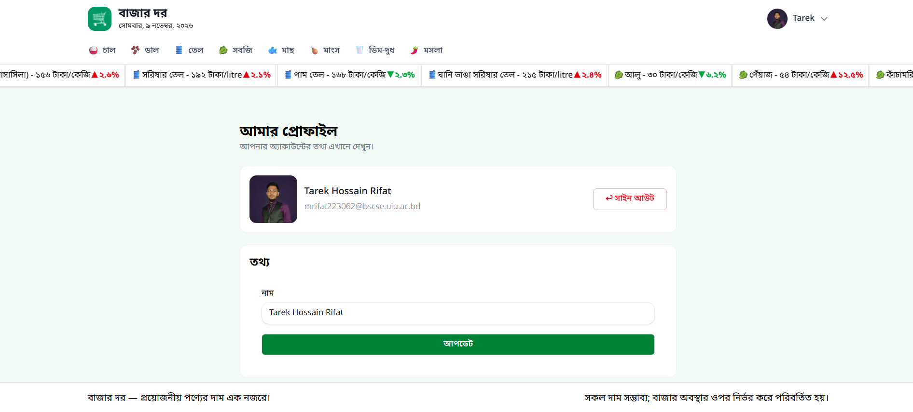

<div align="center">

<!-- Animated project title -->
<p align="center">
  <a href="https://your-project.vercel.app">
    
  </a>
</p>

### প্রয়োজনীয় পণ্যের দাম এক নজরে।

**BazarDor** is a responsive market-price information platform that helps users explore everyday product prices, compare market rates, and track price movements in one place.

[Live Demo](https://assignment-07-tarek-ph-b14.vercel.app/) · [GitHub Repository](https://github.com/tarek-hossain-rifat/assignment_07_tarek_ph_b14) · [Features](#-key-features) · [Installation](#-getting-started) · [API](#-api-reference)


</div>

---

## 📌 Table of Contents

- [About the Project](#-about-the-project)
- [Preview](#-preview)
- [Key Features](#-key-features)
- [Technology Stack](#-technology-stack)
- [Project Structure](#-project-structure)
- [Getting Started](#-getting-started)
- [Environment Variables](#-environment-variables)
- [API Reference](#-api-reference)
- [Authentication](#-authentication)
- [Available Scripts](#-available-scripts)
- [Deployment](#-deployment)
- [Project Links](#-project-links)
- [Acknowledgements](#-acknowledgements)

## 🌐 Live Demo

Explore the deployed application: **[BazarDor — Live Website](https://assignment-07-tarek-ph-b14.vercel.app/)**

Source code: **[GitHub Repository](https://github.com/tarek-hossain-rifat/assignment_07_tarek_ph_b14)**

## 🛒 About the Project

**BazarDor (বাজার দর)** is a web application for viewing the latest available prices of daily essentials. It presents product information in Bengali and provides a simple way to explore price changes and market-wise price ranges.

The application is built with the Next.js App Router. Product and category information is retrieved from the Programming Hero BazarDor API, while Better Auth handles account authentication and MongoDB stores authentication data.

> **Price notice:** Displayed prices are informational estimates and may vary depending on the market and current conditions.

## 🖼️ Preview

Add screenshots of your deployed application to the `screenshots/` directory and update the paths below.

| Home page | Product details |
|:---:|:---:|
|  |  |

| Category page | Authentication |
|:---:|:---:|
|  |  |

| Profile page |
|:---:|:---:|
|  |

## ✨ Key Features

- **Market overview:** Browse everyday essentials and their current listed prices from the home page.
- **Price movement highlights:** See products whose prices have increased or decreased.
- **Live-style price ticker:** View a scrolling summary of product prices and percentage changes.
- **Product details:** Explore minimum, maximum, and average prices along with market-wise price information. Product details require authentication.
- **Category browsing:** Explore products by category and sort them by price, from low to high or high to low.
- **Authentication:** Create an account or sign in using email/password or Google authentication.
- **Profile management:** View account information, update your name, and sign out.
- **Responsive interface:** Layouts are designed to work across desktop, tablet, and mobile screen sizes.
- **Bengali-first presentation:** Product names, units, dates, and price values are presented with Bengali-friendly text and number formatting.
- **Loading and feedback states:** Includes loading placeholders and toast messages for relevant authentication and profile actions.

## 🧰 Technology Stack

| Technology | Purpose |
|---|---|
| [Next.js 16](https://nextjs.org/) | React framework, App Router, server and client components |
| [React 19](https://react.dev/) | Component-based user interface |
| [TypeScript](https://www.typescriptlang.org/) | Static typing and maintainable application code |
| [Tailwind CSS 4](https://tailwindcss.com/) | Utility-first styling and responsive layouts |
| [HeroUI](https://www.heroui.com/) | UI components, forms, buttons, and toast notifications |
| [Better Auth](https://www.better-auth.com/) | Email/password and Google authentication |
| [MongoDB](https://www.mongodb.com/) | Database for authentication data |
| [Programming Hero BazarDor API](https://openapi.programming-hero.com/api/bazardor) | Product and category data |
| [React Marquee Text](https://www.npmjs.com/package/react-marquee-text) | Scrolling market-price ticker |
| [Gravity UI Icons](https://icons.gravity-ui.com/) | Interface icons |

## 📁 Project Structure

```text
bazar-dor/
├── public/
│   ├── bazar-hero.png
│   ├── logo-icon.png
│   ├── icons8-google-48.png
│   └── ...
│
├── screenshots/
|   ├──category.png
|   └── ...
|
|
├── src/
│   ├── app/
│   │   ├── (auth)/
│   │   │   ├── profile/
│   │   │   │   └── page.tsx
│   │   │   ├── sign-in/
│   │   │   │   └── page.tsx
│   │   │   └── sign-up/
│   │   │       └── page.tsx
│   │   │
│   │   ├── api/
│   │   │   └── auth/
│   │   │       └── [...all]/
│   │   │           └── route.ts
│   │   │
│   │   ├── category/
│   │   │   └── [slug]/
│   │   │       └── page.tsx
│   │   ├── components/
│   │   │   ├── AllProduct.tsx
│   │   │   ├── CategoryContent.tsx
│   │   │   ├── CurrentDate.tsx
│   │   │   ├── Footer.tsx
│   │   │   ├── HeroSection.tsx
│   │   │   ├── MarqueesComponent.tsx
│   │   │   ├── Navbar.tsx
│   │   │   ├── PricesDecreased.tsx
│   │   │   ├── PricesIncreased.tsx
│   │   │   ├── ProductDetails.tsx
│   │   │   ├── ProductSort.tsx
│   │   │   └── SingleProductCard.tsx
│   │   ├── product/
│   │   │   └── [slug]/
│   │   │       └── page.tsx
│   │   ├── favicon.ico
│   │   ├── globals.css
│   │   ├── layout.tsx
│   │   └── page.tsx
│   │
│   ├── lib/
│   │   ├── auth-client.ts
│   │   └── auth.ts
│   ├── proxy.ts
│   └── types.ts
│
├── .env.local                 # Create this file locally; do not commit it
├── eslint.config.mjs
├── next.config.ts
├── package.json
├── package-lock.json
├── tsconfig.json
└── README.md
```

## 🚀 Getting Started

Follow these steps to run BazarDor on your local machine.

### Prerequisites

Make sure you have the following installed:

- [Node.js](https://nodejs.org/) (Node.js 20 or later recommended)
- npm (included with Node.js)
- A [MongoDB Atlas](https://www.mongodb.com/atlas) database or compatible MongoDB connection
- Google OAuth credentials from the [Google Cloud Console](https://console.cloud.google.com/) if you want to use Google sign-in

### 1. Clone the repository

```bash
git clone https://github.com/tarek-hossain-rifat/assignment_07_tarek_ph_b14.git
cd assignment_07_tarek_ph_b14
```

### 2. Install dependencies

```bash
npm install
```

### 3. Configure environment variables

Create a `.env.local` file in the project root and add the variables described in the [Environment Variables](#-environment-variables) section.

### 4. Start the development server

```bash
npm run dev
```

Open [http://localhost:3000](http://localhost:3000) in your browser.

### 5. Create a production build

```bash
npm run build
npm run start
```

## 🔐 Environment Variables

Create `.env.local` in the root directory:

```env
# MongoDB connection string used by Better Auth
BETTER_AUTH_DB_URL="your_mongodb_connection_string"

# Google OAuth credentials
BETTER_AUTH_GOOGLE_CLIENT_ID="your_google_client_id"
BETTER_AUTH_GOOGLE_SECRET="your_google_client_secret"

# Better Auth secret (use a long, random, private value)
BETTER_AUTH_SECRET="your_better_auth_secret"

# Public application URL
BETTER_AUTH_URL="http://localhost:3000"
```

**Important:** These are secret or environment-specific values. Never commit `.env.local` or publish database credentials and OAuth secrets. Configure the corresponding variables in your deployment provider as well.

For production, set the application URL to your deployed domain and make sure the Google OAuth authorized redirect URI matches your Better Auth deployment configuration. The current auth client in `src/lib/auth-client.ts` uses `http://localhost:3000`; update its `baseURL` to your production application URL (or an appropriate environment-based URL) before deploying.

## 🌐 API Reference

BazarDor retrieves product and category information from the Programming Hero API.

**Base URL**

```text
https://openapi.programming-hero.com/api/bazardor
```

| Method | Endpoint | Description |
|---|---|---|
| `GET` | `/products` | Retrieve all products |
| `GET` | `/products?category=chal` | Retrieve products in a category (example: `chal`) |
| `GET` | `/products/1` | Retrieve a product by ID (example: `1`) |
| `GET` | `/categories` | Retrieve all categories |
| `GET` | `/categories/chal` | Retrieve a category by slug (example: `chal`) |

**Alternative API base URLs**

```text
https://api.api-store.workers.dev/api/bazardor
https://api.abcz.workers.dev/api/bazardor
```

The application currently uses the primary Programming Hero API URL in its product and category requests.

## 🔑 Authentication

Authentication is implemented with **Better Auth** and a MongoDB adapter.

- Email and password sign-up.
- Email and password sign-in.
- Google OAuth sign-in/sign-up.
- Session-aware navigation and sign-out.
- Protected profile and product-detail routes through `src/proxy.ts`.
- Profile name update using Better Auth's `updateUser` client method.

> **Provider note:** Google OAuth is configured in the current source code. GitHub OAuth is not currently configured, even though it may be listed as an optional provider in the original assignment requirements.

## 📜 Available Scripts

| Command | Description |
|---|---|
| `npm run dev` | Start the local development server |
| `npm run build` | Create an optimized production build |
| `npm run start` | Start the production server |
| `npm run lint` | Run ESLint |

## ☁️ Deployment

BazarDor can be deployed to [Vercel](https://vercel.com/), which supports Next.js applications.

1. Push the project to a GitHub repository.
2. Import the repository into Vercel.
3. Add the required environment variables in **Project Settings → Environment Variables**.
4. Update the Better Auth client base URL in `src/lib/auth-client.ts` for the deployed domain.
5. Add the production OAuth callback URL to your Google Cloud OAuth client configuration.
6. Deploy and test the home page, category pages, sign-in, sign-up, profile, and protected product-detail routes.

## 🔗 Project Links

- **Live Demo:** [https://assignment-07-tarek-ph-b14.vercel.app/](https://assignment-07-tarek-ph-b14.vercel.app/)
- **GitHub Repository:** [tarek-hossain-rifat/assignment_07_tarek_ph_b14](https://github.com/tarek-hossain-rifat/assignment_07_tarek_ph_b14)

## 🙌 Acknowledgements

- [Programming Hero](https://www.programming-hero.com/) for the BazarDor API and project requirements.
- [Next.js](https://nextjs.org/) and [React](https://react.dev/) for the application framework.
- [HeroUI](https://www.heroui.com/) for interface components.
- [Better Auth](https://www.better-auth.com/) for authentication tools.

---

<div align="center">

**Made with ❤️ for a clearer view of everyday market prices.**

</div>
